# BÁO CÁO BÀI TẬP THỰC HÀNH C# WINFORMS (3-TIER ARCHITECTURE)

## MỤC 1: THÔNG TIN SINH VIÊN
* **Họ và tên sinh viên:** Nguyễn Hữu Trường
* **Mã sinh viên:** 24810320290
* **Lớp / Khóa:** D19QTANM1

---

## MỤC 2: HÌNH ÁNH KẾT QUẢ CÁC MÀN HÌNH CHỨC NĂNG

### I. BÀI TẬP 6.3: HỆ THỐNG QUẢN LÝ CÔNG VIỆC & TIẾN ĐỘ DỰ ÁN (PROJECT & TASK MANAGEMENT)

1. **Màn hình Chính / Tổng quan hệ thống:**
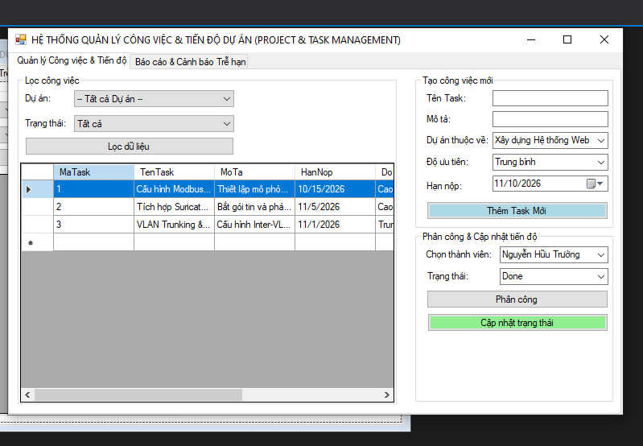

2. **Màn hình Quản lý Danh mục (CRUD - Tạo Task mới 3-Tier):**
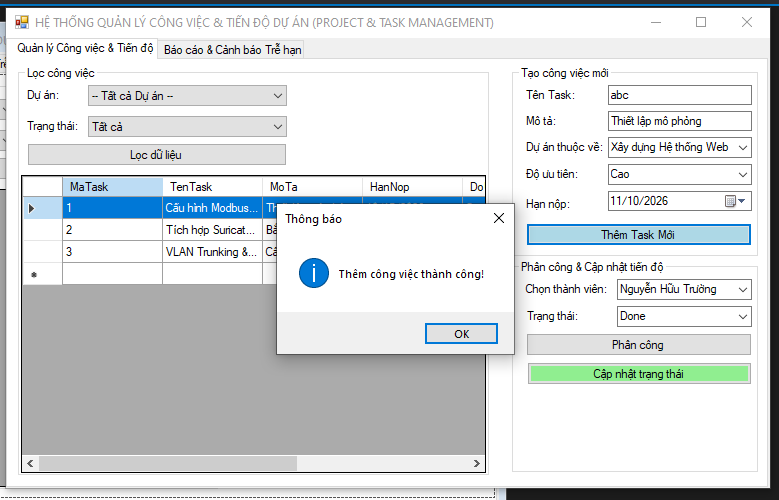

3. **Màn hình Thực thi Nghiệp vụ chính (Phân công & Cập nhật Trạng thái Task):**
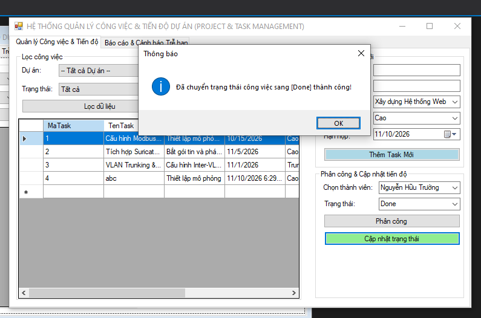

4. **Màn hình Báo cáo - Thống kê (Tỷ lệ % Hoàn thành theo Thành viên):**
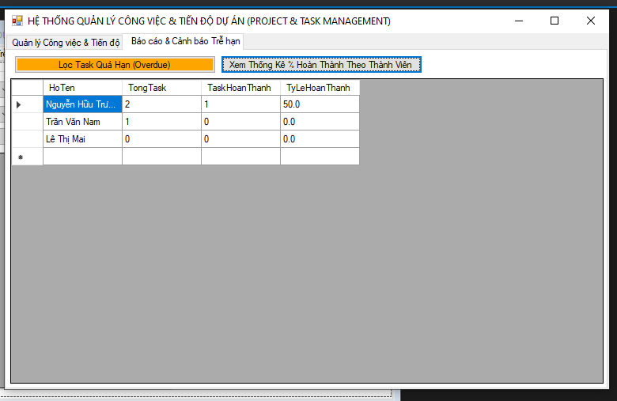

5. **Minh họa An toàn Dữ liệu (Cảnh báo Công việc quá hạn - Overdue Tasks):**
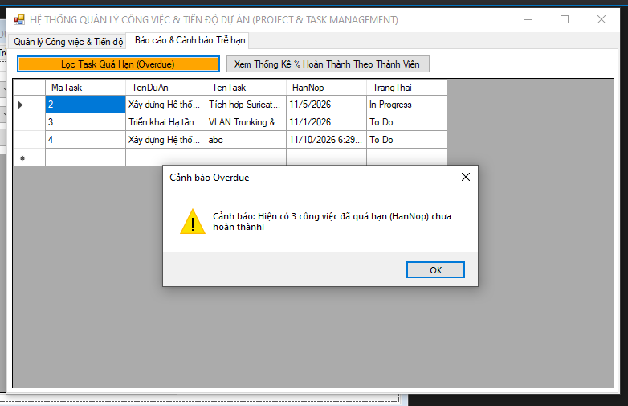

---

### II. BÀI TẬP 6.4: HỆ THỐNG QUẢN LÝ GARAGE VÀ BẢO BƯỠNG XE Ô TÔ (GARAGE MANAGEMENT SYSTEM)

1. **Màn hình Chính / Tổng quan hệ thống:**
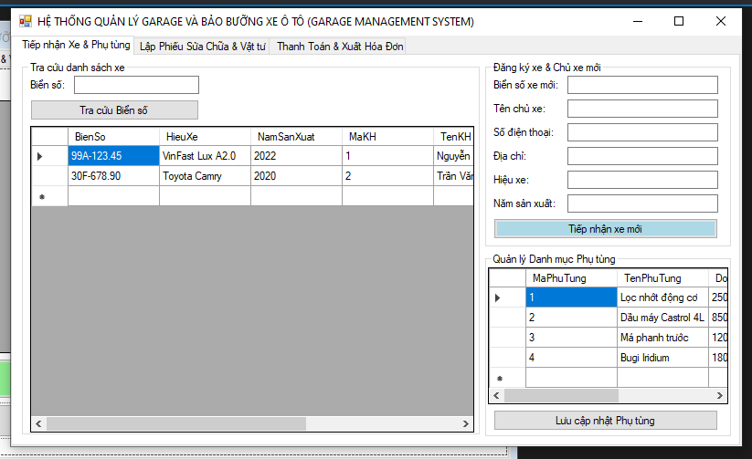

2. **Màn hình Quản lý Danh mục (CRUD - Tiếp nhận Xe & Chủ xe mới):**
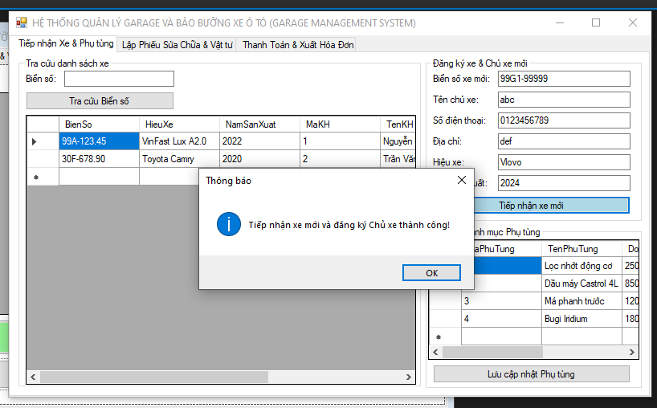

3. **Màn hình Thực thi Nghiệp vụ chính (Lập Phiếu sửa chữa & Thay thế Phụ tùng):**
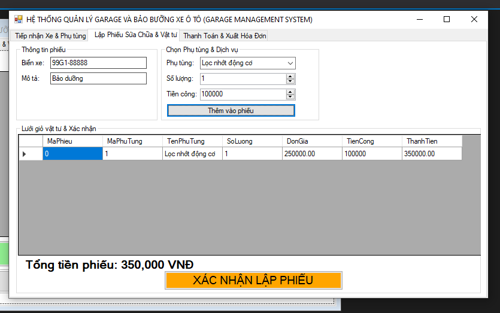

4. **Màn hình Báo cáo - Thống kê (Danh sách Phiếu sửa chữa & Xuất Hóa đơn):**
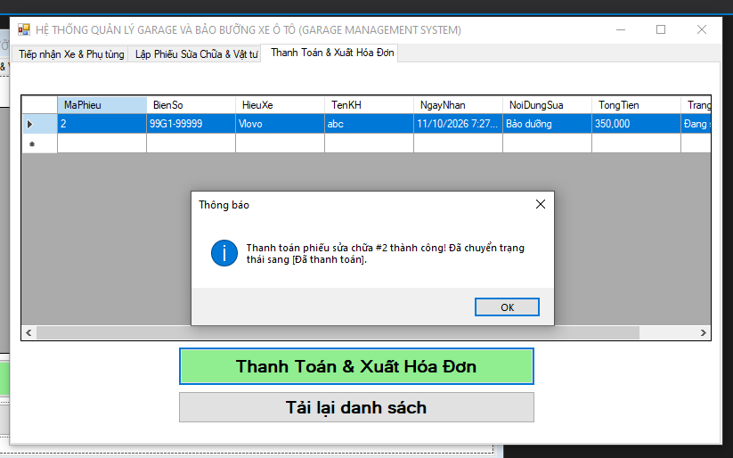

5. **Minh họa An toàn Dữ liệu (Báo lỗi Transaction Rollback khi thiếu Phụ tùng tồn kho):**
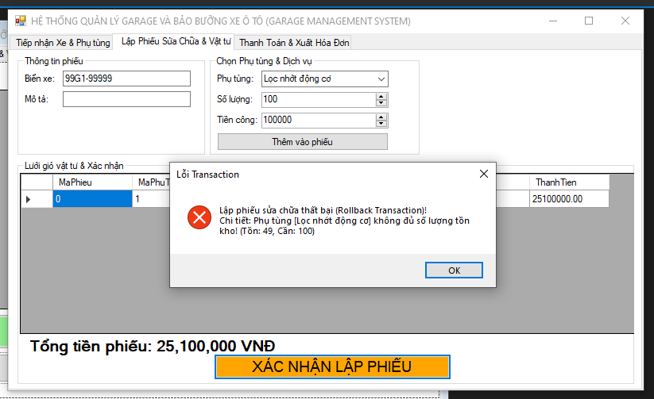

---

### III. BÀI TẬP 6.5: HỆ THỐNG QUẢN LÝ ĐẶT PHÒNG & DỊCH VỤ KARAOKE (KARAOKE MANAGEMENT SYSTEM)

1. **Màn hình Chính / Tổng quan hệ thống (Visual Room Grid Layout):**
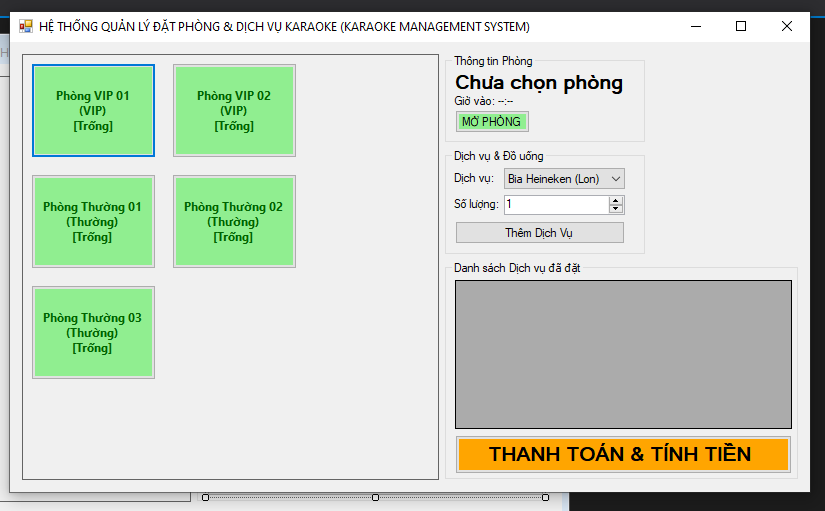

2. **Màn hình Quản lý Danh mục (CRUD - Chọn phòng & Mở phòng hát):**
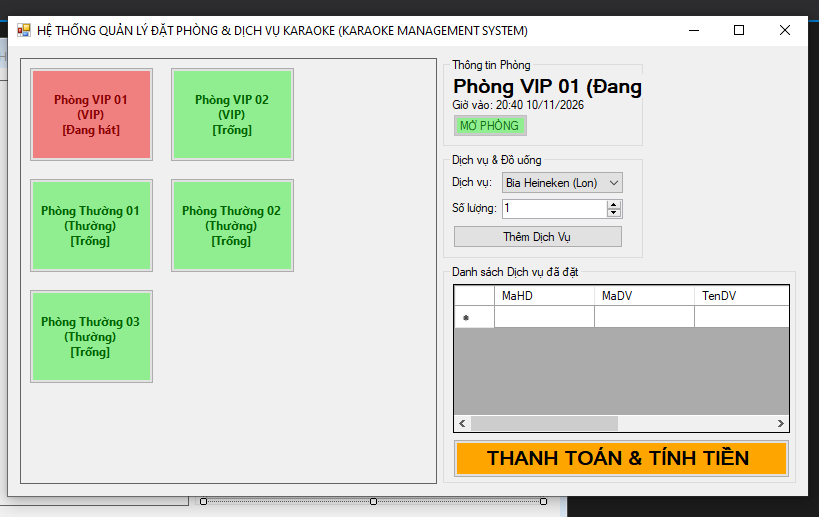

3. **Màn hình Thực thi Nghiệp vụ chính (Gọi Dịch vụ / Đồ uống ngắt kết nối):**
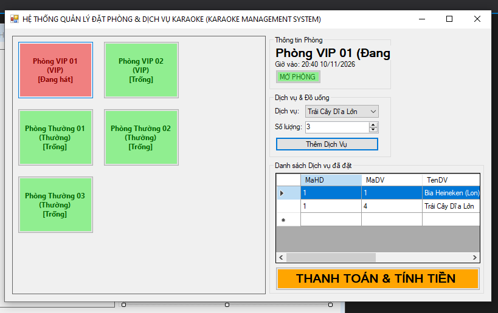

4. **Màn hình Báo cáo - Thống kê (Hóa đơn & Tiền phòng tính tự động):**
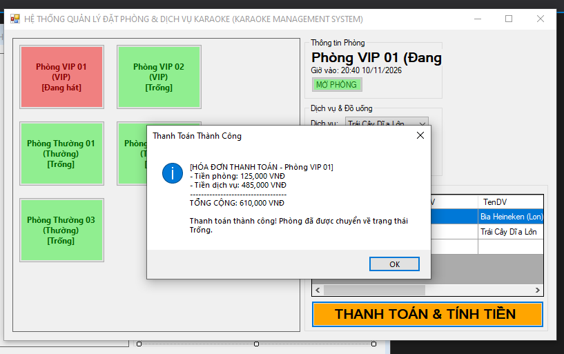

5. **Minh họa An toàn Dữ liệu (Báo lỗi Transaction Rollback khi hết Hàng tồn kho):**
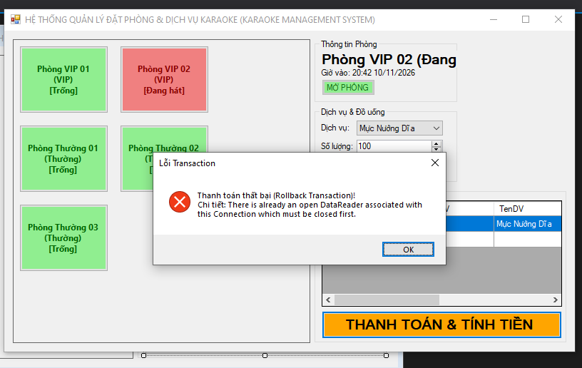